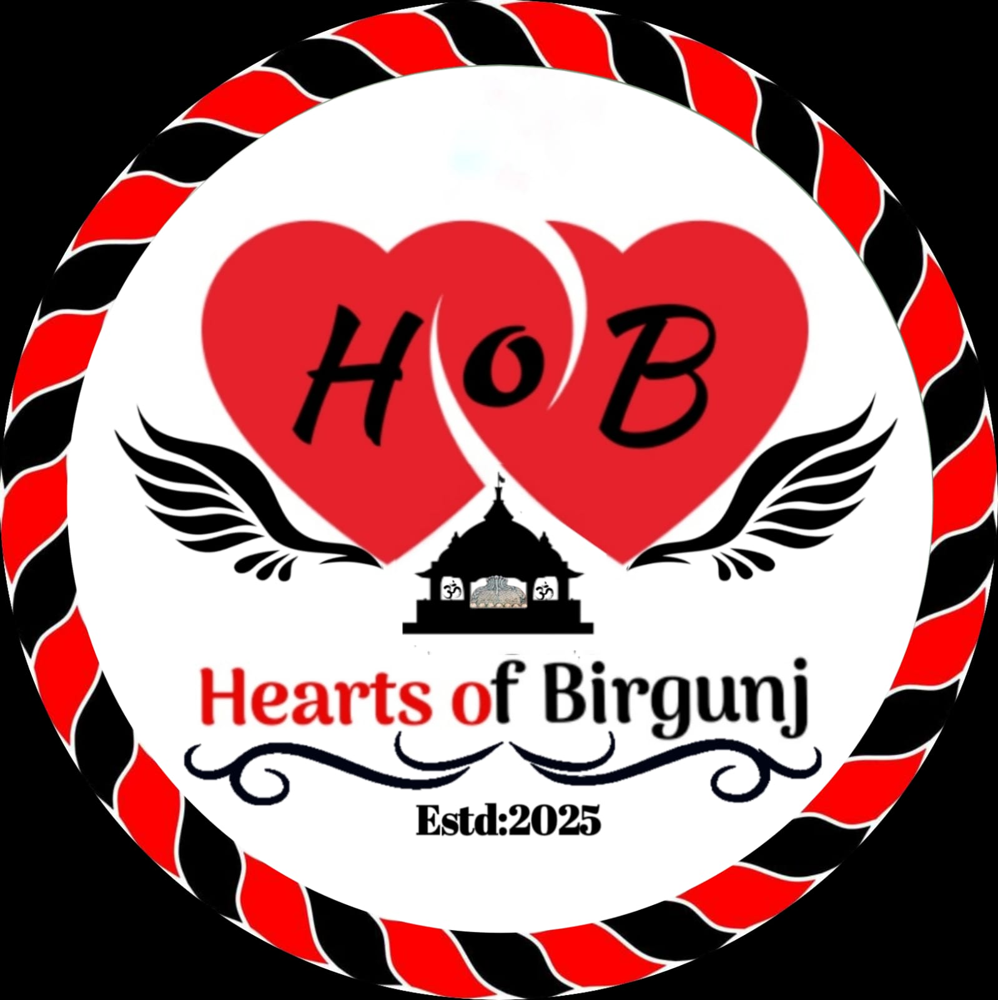
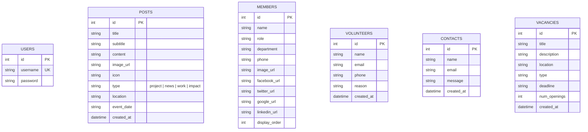

# 🌿 Kalikamai Youth Society Web Platform

<div align="center">

[](https://github.com/Manishsah098/Kalikamai)

### Empowering Youth • Transforming Communities • Inspiring Change

Official full-stack dynamic web portal and management platform for **Kalikamai Youth Society**, a grassroots youth-led non-governmental organization (NGO) based in Parsa, Nepal.

[](https://nodejs.org/)
[](https://expressjs.com/)
[](https://ejs.co/)
[](https://sqlite.org/)
[](https://github.com/expressjs/multer)
[](https://opensource.org/licenses/ISC)

[Explore Public Portal](#-public-portal--features) • [Admin Suite](#-administrative-control-suite) • [Installation](#-getting-started) • [API & Routes](#-routing--api-reference) • [Developer](#-author--developer)

</div>

---

## 📖 Table of Contents

- [🌟 About Kalikamai Youth Society](#-about-kalikamai-youth-society)
- [🎯 Mission & Key Focus Areas](#-mission--key-focus-areas)
- [✨ Key Features](#-key-features)
  - [Public Portal](#-public-portal--features)
  - [Administrative Control Suite](#-administrative-control-suite)
- [🛠️ Tech Stack & Architecture](#️-tech-stack--architecture)
- [📂 Project Structure](#-project-structure)
- [🗄️ Database Architecture](#️-database-architecture)
- [🚀 Getting Started](#-getting-started)
  - [Prerequisites](#prerequisites)
  - [Installation](#installation)
  - [Database Initialization & Admin Account](#database-initialization--admin-account)
  - [Running the Server](#running-the-server)
- [📡 Routing & API Reference](#-routing--api-reference)
- [🔐 Security & Best Practices](#-security--best-practices)
- [🧑‍💻 Author & Developer](#-author--developer)
- [📬 Contact & Organization Info](#-contact--organization-info)
- [📄 License](#-license)

---

## 🌟 About Kalikamai Youth Society

**Kalikamai Youth Society** is a registered non-profit organization located in **Kalikamai Rural Municipality-02 (Bhedihari), Parsa, Nepal**. Driven by passionate youth leaders, the organization implements community-led solutions to uplift marginalized populations, protect children, empower women, and preserve cultural heritage.

This repository powers the organization's dynamic website, public engagement platform, and back-office administrative system.

---

## 🎯 Mission & Key Focus Areas

```
                            ┌─────────────────────────────────────────┐
                            │        Kalikamai Youth Society          │
                            └────────────────────┬────────────────────┘
                                                 │
      ┌──────────────────┬───────────────────────┼───────────────────────┬──────────────────┐
      ▼                  ▼                       ▼                       ▼                  ▼
🎓 Youth & Education 🏥 Health & Child Prot.  ♀️ Gender Equality  🌳 Green Environment 🎭 Cultural Heritage
```

- **🎓 Youth Empowerment & Education**: Leadership training, scholarships, capacity building, and digital literacy.
- **🏥 Healthcare & Child Welfare**: Free medical checkups, cancer awareness, anti-drug initiatives, and child protection.
- **♀️ Women's Rights & Gender Justice**: Campaigns against dowry systems, anti-violence workshops, and legal rights awareness.
- **🌳 Environmental Sustainability**: Mass tree plantation drives, sanitation campaigns, and climate resilience programs.
- **🍱 Food Security & Humanitarian Relief**: Emergency crisis management, disaster relief, and seasonal Prasad/rations distribution.
- **🎭 Cultural Preservation**: Safeguarding and promoting indigenous Madhesi and Mithila folk art, literature, and festivals.

---

## ✨ Key Features

### 🌐 Public Portal & Features

- **Modern Glassmorphism Design**: High-impact visual presentation with gradient accents, responsive typography, and micro-animations.
- **Dynamic Content Showcase**: Live feeds for community projects, impact reports, news releases, and ongoing campaigns.
- **Dedicated News & Project Viewer**: Detailed single-view pages (`/news/:id`) with rich media, timestamps, and location metadata.
- **Interactive Team Directory**: Visual member profiles displaying designations, departments, contact info, and social profiles.
- **Career & Vacancy Board**: Real-time listing of active job openings with position counts, employment type, location, and application deadlines.
- **Online Volunteer Intake**: Integrated registration form allowing prospective volunteers to join community initiatives.
- **Direct Message Inquiries**: Client-side validated contact form with asynchronous database logging.

### 🔐 Administrative Control Suite

- **Protected Admin Gateway**: Session-backed authentication with `bcryptjs` password hashing and brute-force resistant routes.
- **Unified Management Dashboard**: Centralized dashboard to overview and maintain all published media and incoming inquiries.
- **Dynamic Content Editor**: Create, update, and delete news posts, impact stories, and community projects.
- **Integrated Image Handling**: Seamless local asset uploading via `Multer` with unique timestamp filename generation.
- **Member & Team Roster Management**: Add new team members, edit roles, sort display order, and upload profile pictures.
- **Vacancy Publishing Hub**: Create and update job posts with dynamic opening counts and deadline trackers.
- **Inbound Message & Volunteer Submissions**: Review and prune contact form inquiries and volunteer sign-ups.

---

## 🛠️ Tech Stack & Architecture

| Layer | Technology | Purpose |
|---|---|---|
| **Server / Runtime** | [Node.js](https://nodejs.org/) (v16+) | JavaScript runtime environment |
| **Web Framework** | [Express.js](https://expressjs.com/) (v5.x) | HTTP server, middleware routing, and REST endpoints |
| **View Engine** | [EJS (Embedded JavaScript)](https://ejs.co/) | Server-side template rendering |
| **Database** | [SQLite3](https://sqlite.org/) | File-based lightweight SQL database (`database.sqlite`) |
| **Authentication** | `express-session` + `bcryptjs` | Secure session management & salted password hashing |
| **File Storage** | [Multer](https://github.com/expressjs/multer) | Multi-part form data & image upload handling |
| **Frontend Styling** | Vanilla Modern CSS3 | Custom design system, CSS Grid/Flexbox, Glassmorphism UI |
| **Iconography & Fonts** | [Font Awesome 6.4](https://fontawesome.com/) + [Google Fonts](https://fonts.google.com/) | UI icons, Outfit & Inter typography |

---

## 📂 Project Structure

```bash
Kalikamai/
├── assets/                     # Media uploads, project images, logos, and developer assets
├── views/                      # Server-side EJS templates
│   ├── index.ejs               # Homepage (Hero, Impact stats, Vacancies, News feed)
│   ├── developer.ejs           # Developer profile & credentials
│   ├── impact-dynamic.ejs      # Community impact overview page
│   ├── members-dynamic.ejs     # Team members and leadership roster
│   ├── news-detail.ejs         # Single post / article reader
│   ├── projects-dynamic.ejs    # Active & completed projects view
│   ├── work-dynamic.ejs        # Core areas of intervention
│   └── admin/                  # Protected management interfaces
│       ├── login.ejs           # Admin authentication portal
│       ├── dashboard.ejs       # Main posts dashboard (CRUD overview)
│       ├── create.ejs          # Post publishing form
│       ├── edit.ejs            # Post modification form
│       ├── members.ejs         # Team management list
│       ├── members-create.ejs  # Add team member form
│       ├── members-edit.ejs    # Edit team member form
│       ├── vacancies.ejs       # Vacancies listing & management
│       ├── vacancies-create.ejs# Vacancy posting form
│       ├── vacancies-edit.ejs  # Vacancy editing form
│       ├── volunteers.ejs      # Volunteer application inbox
│       └── contacts.ejs        # Contact inquiry inbox
├── database.sqlite             # Auto-generated SQLite relational database
├── db.js                       # SQLite schema initialization and connection pool
├── package.json                # Project dependencies and configurations
├── script.js                   # Client-side JavaScript (counters, smooth scroll, modals)
├── seed-content.js             # Database seeder for sample data
├── server.js                   # Express application entry point & routing definitions
├── setup-db.js                 # Admin user provisioning script
└── style.css                   # Global stylesheet & design system
```

---

## 🗄️ Database Architecture

The application utilizes an embedded SQLite database (`database.sqlite`) initialized via `db.js`. Key tables include:



---

## 🚀 Getting Started

Follow these steps to set up and run the Kalikamai Youth Society platform locally.

### Prerequisites

Ensure you have the following installed on your machine:
- **[Node.js](https://nodejs.org/)** (v16.x or higher)
- **[npm](https://www.npmjs.com/)** (v8.x or higher)
- **[Git](https://git-scm.com/)**

### Installation

1. **Clone the Repository:**
   ```bash
   git clone https://github.com/Manishsah098/Kalikamai.git
   cd Kalikamai
   ```

2. **Install Node Dependencies:**
   ```bash
   npm install
   ```

### Database Initialization & Admin Account

1. **Initialize the SQLite Database & Default Admin:**
   ```bash
   node setup-db.js
   ```
   > 💡 **Default Credentials:**
   > - **Username:** `admin`
   > - **Password:** `admin`
   > *(Note: For production deployments, ensure you update these credentials immediately).*

2. *(Optional)* **Seed Sample Content:**
   ```bash
   node seed-content.js
   ```

### Running the Server

Start the application:

```bash
node server.js
```

Or run using `nodemon` for active development:
```bash
npx nodemon server.js
```

- 🌐 **Public Website**: [`http://localhost:3000`](http://localhost:3000)
- 🔐 **Admin Portal**: [`http://localhost:3000/admin/login`](http://localhost:3000/admin/login)

---

## 📡 Routing & API Reference

### Public Routes

| Method | Endpoint | Description |
|---|---|---|
| `GET` | `/` | Homepage with hero section, latest news, and vacancy notices |
| `GET` | `/projects.html` | Projects & initiatives archive |
| `GET` | `/work.html` | Organizational focus pillars |
| `GET` | `/impact.html` | Community impact reports |
| `GET` | `/members.html` | Executive and general members directory |
| `GET` | `/news/:id` | Detailed single-post reader |
| `GET` | `/developer.html` | Developer biography and engineering credits |

### Public Submission APIs

| Method | Endpoint | Payload | Description |
|---|---|---|---|
| `POST` | `/api/volunteers` | `{ name, email, phone, reason }` | Submit volunteer application |
| `POST` | `/api/contacts` | `{ name, email, message }` | Submit direct contact message |

### Admin Control Routes (Protected)

| Method | Endpoint | Description |
|---|---|---|
| `GET` / `POST` | `/admin/login` | Admin authentication portal & session initialization |
| `GET` | `/admin/logout` | Terminate session and redirect |
| `GET` | `/admin/dashboard` | Main posts management view |
| `GET` / `POST` | `/admin/create` | Render form / Upload & create post (`multipart/form-data`) |
| `GET` / `POST` | `/admin/edit/:id` | Render form / Update post details and media |
| `POST` | `/admin/delete/:id` | Delete post entry |
| `GET` / `POST` | `/admin/members/*` | Full CRUD operations for team members |
| `GET` / `POST` | `/admin/vacancies/*`| Full CRUD operations for vacancy notices |
| `GET` / `POST` | `/admin/volunteers/*`| View / Delete volunteer submissions |
| `GET` / `POST` | `/admin/contacts/*` | View / Delete contact inquiries |

---

## 🔐 Security & Best Practices

- **Password Hashing**: Stored passwords use `bcryptjs` with salt rounds (factor 10) to mitigate plain-text leaks.
- **Route Guards**: `requireAuth` middleware enforces session validity on all administrative endpoints.
- **SQL Sanitization**: All database interactions use parameterized SQL statements to guard against SQL Injection vulnerabilities.
- **Multer Storage Isolation**: File uploads are restricted to the designated `assets/` directory with collision-resistant timestamps.

---

## 🧑‍💻 Author & Developer

<div align="center">

### **Manish Kumar Sah**
*Fullstack Software Engineer & Founder of Bikrama Technosoft*

[](https://www.facebook.com/share/1BrpTHK33A/)
[](https://www.instagram.com/manishshah2332)
[](https://www.linkedin.com/in/manish-kumar-sah-917116367)

📞 **Contact**: `+977 9811807618` | `+91 7250140014`

</div>

---

## 📬 Contact & Organization Info

<div align="center">

| Channel | Details |
|---|---|
| 🏢 **Organization** | **Kalikamai Youth Society (कालीकामाई युवा समाज)** |
| 📍 **Address** | Kalikamai Rural Municipality-02 (Bhedihari), Parsa, Madhesh Province, Nepal |
| 📞 **Phone** | `+977-9763368173` |
| 📧 **Official Email** | [kalikamaiyouthsociety@gmail.com](mailto:kalikamaiyouthsociety@gmail.com) |
| 🌐 **Facebook Page** | [Kalikamai Yuva Samaj](https://www.facebook.com/kalikama.i.yuva.samaja) |

</div>

---

## 📄 License

This project is licensed under the **[ISC License](https://opensource.org/licenses/ISC)**.

```
Copyright (c) 2026 Kalikamai Youth Society.
Permission to use, copy, modify, and/or distribute this software for any purpose
with or without fee is hereby granted, provided that the above copyright notice
and this permission notice appear in all copies.
```

<div align="center">
  <sub>Made with ❤️ for community empowerment and youth development in Nepal.</sub>
</div>
